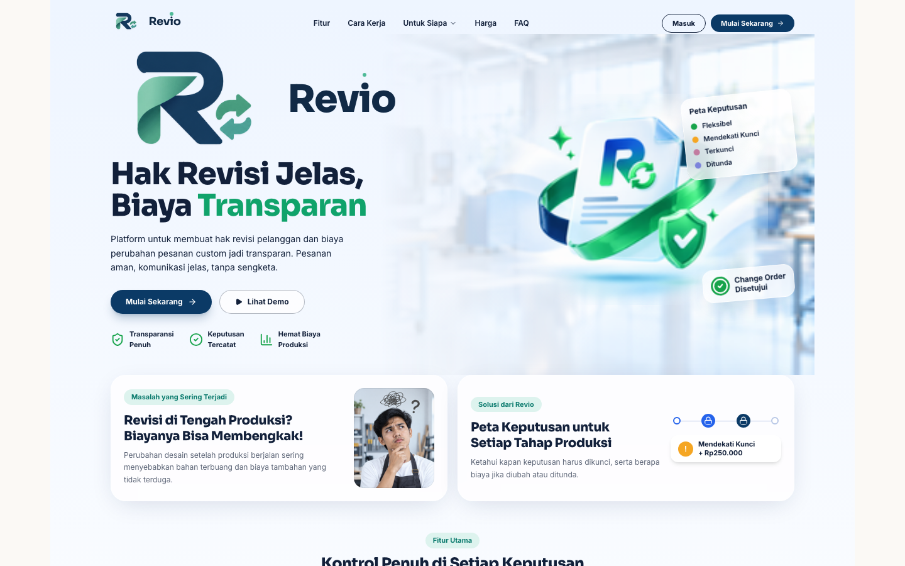
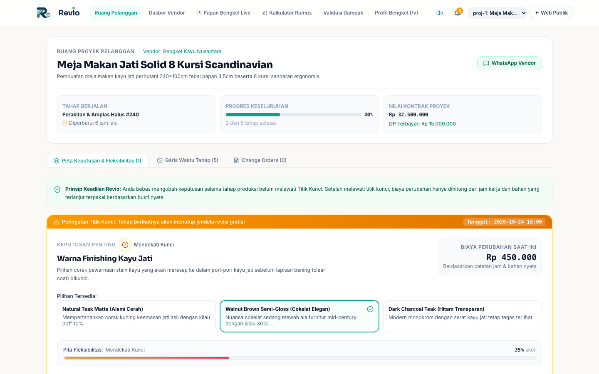
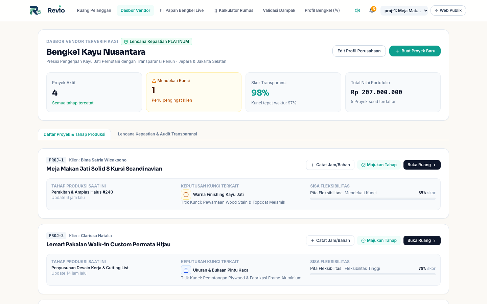
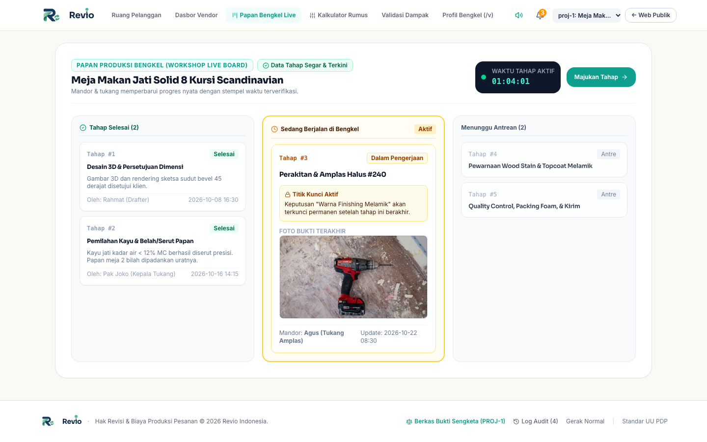
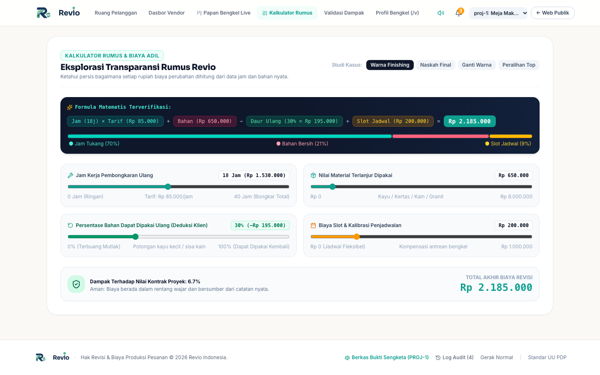
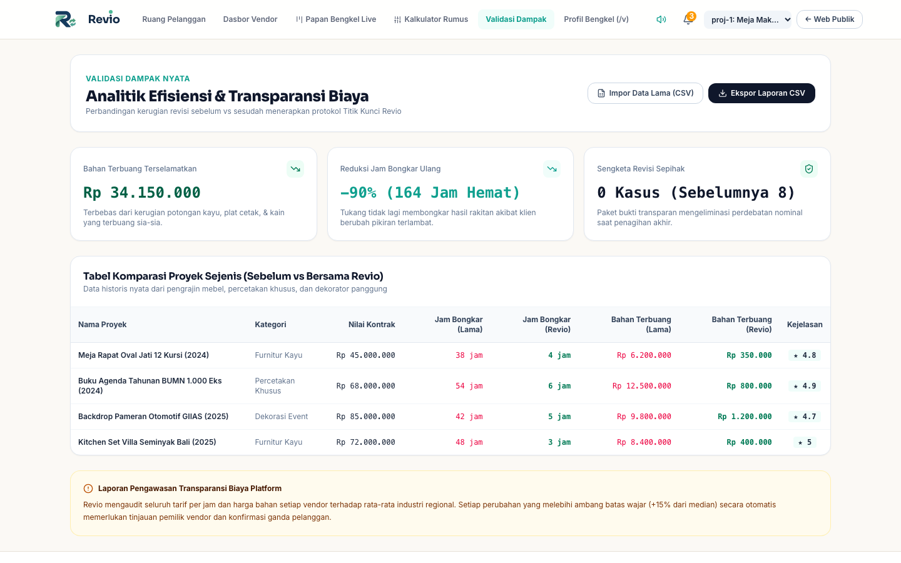
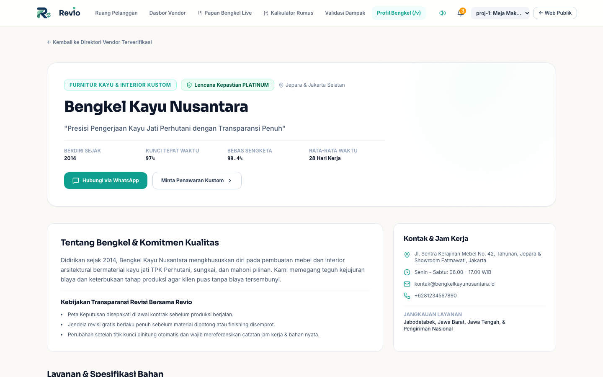

<p align="center">
  
</p>

<h1 align="center">Revio</h1>

<p align="center">
  Platform transparansi <b>hak revisi</b> dan <b>biaya produksi</b> untuk pesanan kustom<br>
  (furnitur, percetakan khusus, dekorasi panggung, konveksi).
</p>

<p align="center">
  
  
  
  
</p>



## Masalahnya

Pelanggan mengubah desain di tengah produksi, bahan sudah terpotong, dan biaya tambahan baru muncul belakangan tanpa dasar yang jelas. Revio mengikat setiap keputusan penting ke **titik kunci** tahap produksi, sehingga pelanggan tahu kapan sebuah keputusan harus dikunci dan berapa biayanya kalau diubah atau ditunda, lengkap dengan bukti kerja nyata.

## Fitur

### Ruang Proyek Pelanggan
Peta keputusan dengan status *Fleksibel*, *Mendekati Kunci*, *Terkunci*, dan *Ditunda*. Setiap keputusan menjelaskan kenapa perubahan jadi mahal setelah melewati sebuah tahap, dan menawarkan tiga tindakan: **Kunci Sekarang** (tahan 1 detik untuk mencegah salah klik), **Tunda** (simulasi biaya), atau **Ajukan Perubahan** (change order).



### Dasbor Vendor
Vendor mengelola proyek, tahap produksi, catatan jam kerja dan bahan, serta persetujuan change order dari satu tempat.



### Papan Bengkel Live
Papan kanban untuk memantau tahap produksi yang sedang berjalan di bengkel.



### Kalkulator Rumus
Rumus biaya perubahan dibuat terlihat, bukan kotak hitam:

```
Biaya = (Jam Kerja × Tarif) + Bahan Terpakai − Deduksi Pakai Ulang + Biaya Jadwal
```



### Validasi Dampak
Perbandingan sebelum dan sesudah memakai Revio (bahan terbuang, jam bongkar ulang, sengketa), dengan impor data historis dan ekspor CSV.



### Profil Bengkel Publik
Halaman publik vendor berisi layanan, spesifikasi bahan, galeri portofolio, kontak WhatsApp, dan Lencana Kepastian, dengan editor profil yang punya pratinjau berdampingan.



### Lainnya
- **Change Order & Paket Bukti**: Berita Acara Perubahan Kerja yang bisa dicetak atau diunduh, memakai logo Revio dan vendor.
- **Log Audit**: stempel waktu setiap perubahan tahap, persetujuan change order, dan penguncian keputusan.
- **Animasi khas Revio**: Hold-to-Lock dengan konfeti, Pita Fleksibilitas, Gembok Hidup, dan garis waktu yang menggambar diri. Menghormati pengaturan *reduced motion*.

## Menjalankan

Butuh Node.js 20 atau lebih baru.

```bash
npm install
npm run dev      # http://localhost:3000
npm run build    # hasil build di dist/
npm run lint     # pengecekan tipe (tsc --noEmit)
```

Aplikasi ini murni frontend. Data demo (proyek, vendor, log audit) ada di [src/data/mockSeedData.ts](src/data/mockSeedData.ts), tanpa backend dan tanpa environment variable.

## Deploy ke Vercel

Tidak perlu konfigurasi tambahan: Vercel mendeteksi Vite otomatis.

1. Import repo ini di [vercel.com/new](https://vercel.com/new).
2. Biarkan Framework Preset **Vite** (build `npm run build`, output `dist`).
3. Deploy.

Navigasi memakai state di dalam aplikasi, tanpa route URL, jadi tidak perlu aturan rewrite.

## Struktur

```
src/
├── components/
│   ├── public/        # Landing page
│   ├── customer/      # Ruang Proyek Pelanggan
│   ├── vendor/        # Dasbor, profil publik, editor, proyek baru
│   ├── workshop/      # Papan Bengkel Live
│   ├── calculator/    # Kalkulator Rumus
│   ├── analytics/     # Validasi Dampak
│   ├── changeorder/   # Modal dan dokumen Berita Acara
│   ├── dispute/       # Paket bukti sengketa
│   ├── motion/        # Animasi khas Revio
│   └── ui/            # Komponen dasar
├── data/              # Data seed demo
├── lib/               # Token animasi, suara, cetak dokumen
└── types/             # Tipe TypeScript
docs/
├── audit/             # Catatan audit dan keputusan
└── screenshots/       # Gambar untuk README
```

Catatan keputusan arsitektur ada di [DECISIONS.md](DECISIONS.md).

## Author & License

Created by Vassel Goleyu. Copyright (c) 2026 Vassel Goleyu. All rights reserved. Lihat [LICENSE](LICENSE).
